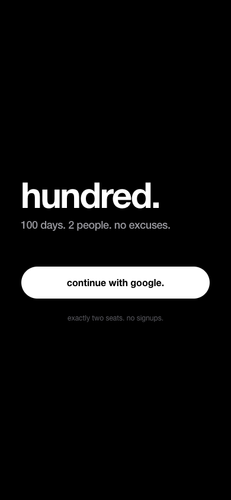
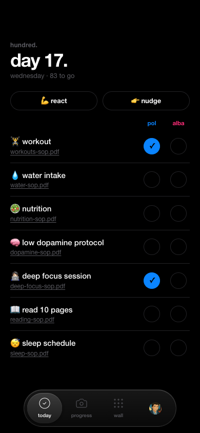
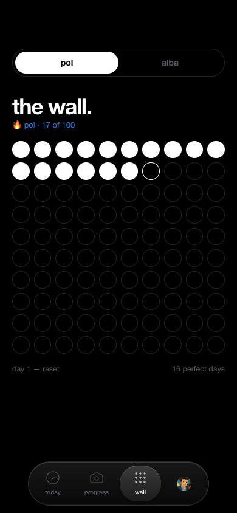

# hundred.

> 100 days. 2 people. no excuses.

A private, two-person 100-day-challenge PWA built for me and my partner. Every day you both tap your goals; miss one and the run resets to day 1. Real push notifications, live updates, and a design system that's pure black and bold Helvetica.

**Live app:** invite-only, exactly two seats.
**Source:** private. This repo is the case study.

  
  
  

## What it does

- **Today**: a shared checklist, one column per person, updating live as your partner ticks things off. React or nudge them from the same screen.
- **The wall**: a 100-dot grid per person showing the current unbroken run.
- **Strict resets**: a missed day sends the run back to day 1, and a scheduled job decides that, not the client.
- **Progress photos and reactions**: emoji, short text and selfies between the two of you.
- **Push notifications**: about three a day per person, rotated from message pools so they don't turn into noise.
- **Installable**: works as a PWA on iOS and Android.

## Stack

| Layer | Choice |
|---|---|
| App | Next.js 16 (App Router, Turbopack), TypeScript, Tailwind v4, shadcn/ui |
| Data and auth | Supabase: Postgres, Google sign-in, Row Level Security, Realtime |
| Push | Web Push (VAPID), sent server-side |
| Scheduling | Supabase Edge Function invoked every 15 minutes by `pg_cron` + `pg_net` |
| Hosting | Vercel |

## Engineering decisions worth talking about

**Security lives in the database, not the UI.** Every table is protected by Row Level Security. A third Google account can sign in, but it isn't bound to either seat, so every policy rejects it. "This app is full" is enforced by Postgres, not by hiding a button. Check-ins can only be written to your own slot, for today, while the challenge is active.

**The server owns the truth about a day.** Clients only ever write plain check-ins. Pass/fail results (`day_results`) are written by a scheduled job with the service role, so nobody can edit their own streak.

**Streak semantics I had to design.** "Strict reset" and "one 100-dot wall per person" only reconcile one way: each person's day number is their own current streak. In team mode, one miss resets both.

**No secrets in git.** The scheduled job needs the service-role key to authorise its own call. Instead of committing it in a migration, it lives in Supabase Vault and is referenced by name from SQL.

**Notifications designed against habituation.** All copy comes from pools, picked deterministically from the Madrid date. It's varied day to day, but retrying the same tick produces the same message, which keeps the job idempotent. Intermediate check-ins don't push at all, because the partner already sees them live. That cut volume from about 8 to about 3 a day.

**Shared code across two runtimes.** The notification copy and scheduling rules are pure TypeScript, imported unchanged by both the Deno edge function and the Node server actions.

## Status

In daily use. Source available to discuss in an interview.
